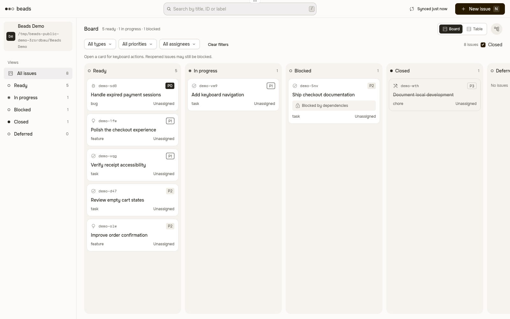
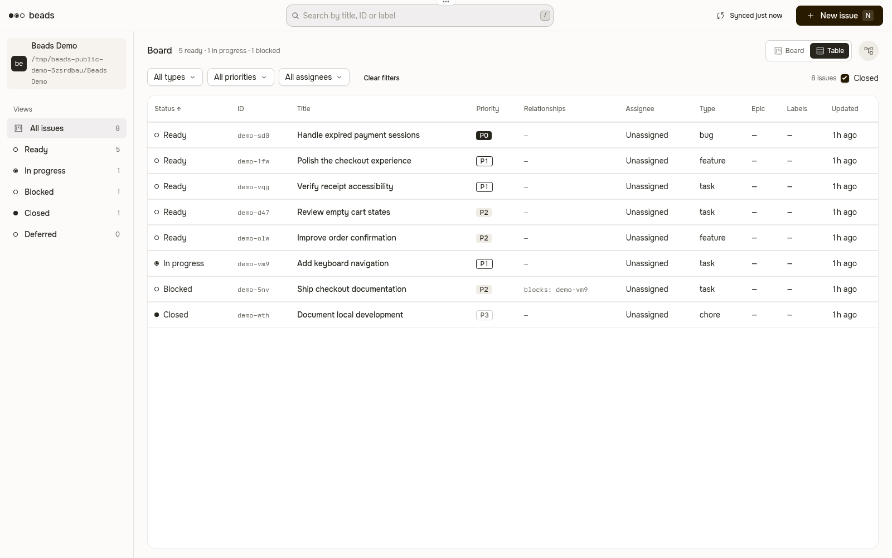
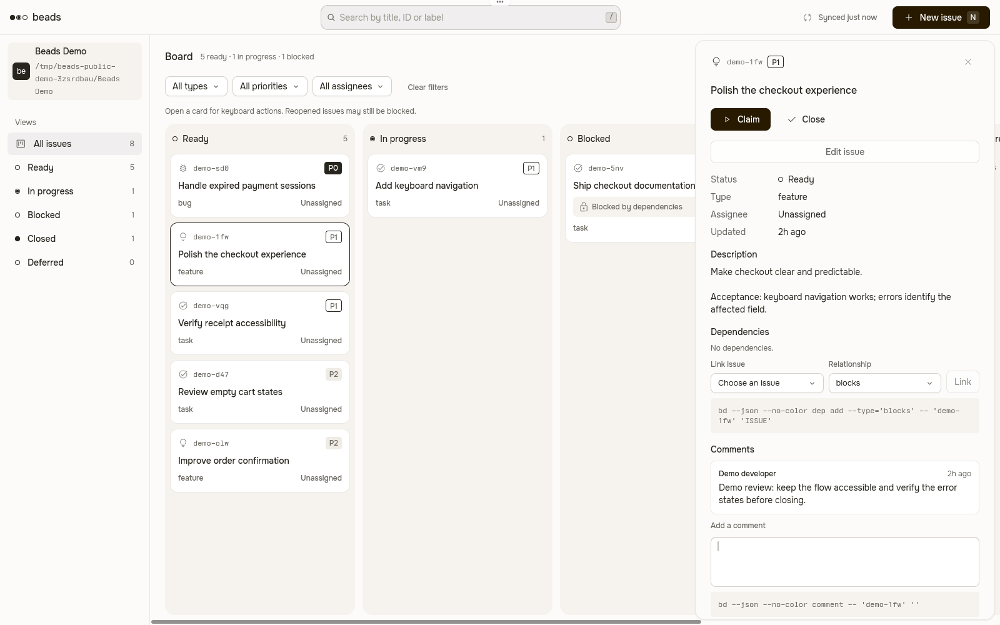

# Beads for Tern

**The Beads design from Orca. Native to Tern.**

Find ready work, follow dependencies, and update tasks beside your shell. A genuine native `beads.board` block: Luau renders the interface; a small TypeScript bridge runs your installed Beads CLI. No browser server, Electron app, or other IDE runtime.

[Русский](README.ru.md) · [Releases](https://github.com/Roflochinsky/beads-tern/releases) · [Native integration](docs/tern.md) · [Approved roadmap](docs/product-scope.md)



Real Tern 0.9.12 on Linux, using a synthetic Beads project. Cropped to the plugin surface; not a browser mockup. Onest was available to the isolated rendering process.

**Pre-release:** the public binary release is held for visual acceptance. Onest installation and compact behavior in split panes need an explicit decision; [the native constraints](docs/tern.md#proven-api-limitations) are not claimed as 1:1 parity. Source installation is available below.

## Install

Requirements on the **machine running the panes**:

- Tern with the API shipped in **0.9.12 (`e498b49`)**. Tern is a closed beta; other versions need compatibility verification.
- **Node.js 24+** and **`bd` 1.3.2** on the Tern daemon's PATH.
- An initialized Beads project with `.beads`. The plugin never initializes or migrates your project.

For the reference typography, **Onest must be available on the rendering client**, separately from the remote machine running bd. [Get Onest from its Google Fonts source](https://github.com/google/fonts/tree/main/ofl/onest). Tern ignores plugin `@font-face`; the plugin does not install fonts or change the host theme. Without Onest, Tern substitutes its sans face, which is not visual parity.

Install the current source as a native plugin:

```sh
git clone https://github.com/Roflochinsky/beads-tern.git
cd beads-tern
npm ci
npm run build
tern plugin install "$PWD/dist/tern"
tern plugin list --json
```

Open a shell in your Beads project, then choose **New Beads block** in Tern's command palette. The source path above needs build dependencies. Once a release is published, its archive will contain the compiled bridge: verify `SHA256SUMS`, extract the archive, then run `tern plugin install "$PWD/tern"` without npm or a development link.

**Do not pass the archive URL to `tern plugin install`.** The [official install contract](https://docs.stencil.so/tern/guides/distribution.md#installing) accepts local directories or Git sources, not release archives. HTTP(S) URLs are cloned with Git. This source repository requires a build; installing its root or `integrations/tern` directly does not supply the bridge. There is no official marketplace.

Installing runs trusted code with your account's access and reloads plugins. To update an installed copy, use `tern plugin install "$PWD/tern" --force`. A linked development package must first be unlinked with `tern plugin unlink beads`. Remove an installed copy with `tern plugin remove beads`; Tern retains its plugin data. Use `tern plugin dir` rather than guessing the configuration path.

Migrating from beads-hud's historical native 0.1.2: the plugin ID remains `beads` and the block remains `beads.board`. Standalone releases restart at 0.1.0; Tern does not compare version strings, so install with `--force`. Old HUD releases remain historical artifacts, not the source for future Tern updates.

## What works today

- **Find work:** board/table views, search by title/ID/label, type/priority/assignee filters, status views and table sorting. Ready comes from `bd ready`, not guessed status rules.
- **Understand dependencies:** the same 240 px navigation, horizontal columns, compact cards and 480 px detail drawer as Orca; dependency navigation, highlighting and Link/Unlink.
- **Update real tasks:** a modal create form, inline editing, Claim, Reclaim, Close, Reopen and readable comments. Status changes use explicit actions, not a free-text status field.
- **Keep other edits intact:** Edit submits only fields changed from the form's baseline. This is not atomic protection against another actor editing the same field.
- **Stay current:** authoritative refresh after mutations and background polling without locking local controls. Older reads are discarded after a newer user request. Polling pauses while composing; only layout/status-view preferences persist.

`/` focuses search; `1` / `2` / `3` select Ready / Active / Blocked; `j` / `k` select an issue; `c` claims; `x` closes or reopens; `n` creates; `r` refreshes; Escape cancels. In forms, Tab moves fields, arrows change a focused choice, and Ctrl/Cmd+Enter saves. Text fields support Unicode, Shift-selection and Ctrl/Cmd+A. Tern's **Native composer editing** preference adds native mouse selection and caret placement. See [full behavior and limitations](docs/tern.md).

No agent launches, handoffs, bulk assignment, saved named filters, document opening, or automatic closure are implemented. Closing is an explicit Beads action; agent completion never closes a task.

### See the workflow

| Table | Issue details |
| --- | --- |
|  |  |

[Create form](docs/images/tern-create.png) · [Compact window](docs/images/tern-narrow.png) · [Compact issue details](docs/images/tern-narrow-detail.png)

The visual reference is [beads-orca v0.1.2](https://github.com/Roflochinsky/beads-orca/tree/v0.1.2/src/ui), including its Material Symbols SVGs. Compact layout currently follows the **window** width; zoom the block when using a narrow split. Split-pane pixel parity is not established.

## Native host, remote panes, and trust

The block uses its pane's `cx.cwd`. RPC callers cannot choose arbitrary filesystem paths. On a remote pane host, install this plugin, Node and bd **there**: the bridge and Beads run there, not against a coincidentally matching local path. Attached clients render the host's native block. iOS alone cannot run this bridge. There is no cross-host project dashboard today.

If Node is not on the daemon's PATH, set `BEADS_TERN_NODE` to an absolute Node executable path **before starting the daemon**; do not include arguments. Changing a shell environment does not update an already-running daemon.

The plugin launches argv arrays, not shell strings. It opens no HTTP port and reads no model credentials. It trusts project-level Beads configuration and is **not a database sandbox**: bd 1.3.2's exact-ID precheck and subsequent operation are separate processes, so configured prefix routing can still race with external deletion. Refresh before retrying a timed-out mutation; it may already have completed. See the [CLI contract](src/core/README.md).

Tern requires a Luau host and native node trees, not a DOM/TypeScript mount. Its renderer cannot load plugin fonts, and its host block API reports pane sizes in terminal cells rather than pixels. Native drag/drop and browser hover behavior are not claimed as equivalent. Tern exposes no process cancellation handle; closing a block ignores in-flight completions but an already-started bounded process can finish.

## Approved roadmap — not implemented

Multi-select with explicit preview; launch/handoff **only to OMP**; blocker-aware task groups; distinct executor Claim before work; linked Markdown context; personal handoff history; saved filters; explicit remote-host availability and per-workspace delivery. No Codex/Claude selector, autonomous dispatcher, silent retries, automatic merges or auto-close. Human review remains the completion gate. [Product decisions and API boundaries](docs/product-scope.md).

## Develop and verify

```sh
npm ci
npm run typecheck
npm run build
npm test
npm run smoke
npm run package
```

Build produces `dist/tern`; package produces only `release/beads-tern-0.1.0.tar.gz` and `release/SHA256SUMS`. For local installation after building: `tern plugin install "$PWD/dist/tern"`. Development linking is optional, not the public installation path.

Tests preserve the service's behavior and the bridge's actual stdin/stdout boundary. `smoke` drives the built bridge against real bd in a disposable isolated Git/Beads project and cleans it up (use `-- --keep` to retain it). No user database or OMP session is needed. Native rendering requires a real Tern window; [native acceptance instructions](docs/tern.md#verification) describe isolation and the manual regression cases. Automated CI is not native-window acceptance.

CI runs on main, pull requests and `v*` tags with Node 24, commit-pinned Actions, locked dependencies and checksum-verified bd 1.3.2. A matching `v<package version>` tag publishes only the Tern archive and checksums after Linux/macOS checks. Publishing a workflow is not evidence that those checks have passed.

## License and ownership

[MIT](LICENSE). Material Symbols SVGs retain their [Apache-2.0 license](integrations/tern/ICONS-LICENSE). Extracted from beads-hud commit `aea263c8def2e91d7e670fa193bcba1cb9ba8bff`; visual reference from beads-orca v0.1.2. This repository owns Tern; [beads-hud](https://github.com/Roflochinsky/beads-hud) owns the browser HUD and other native platforms, and [beads-orca](https://github.com/Roflochinsky/beads-orca) owns Orca. No runtime dependency connects these repositories.
