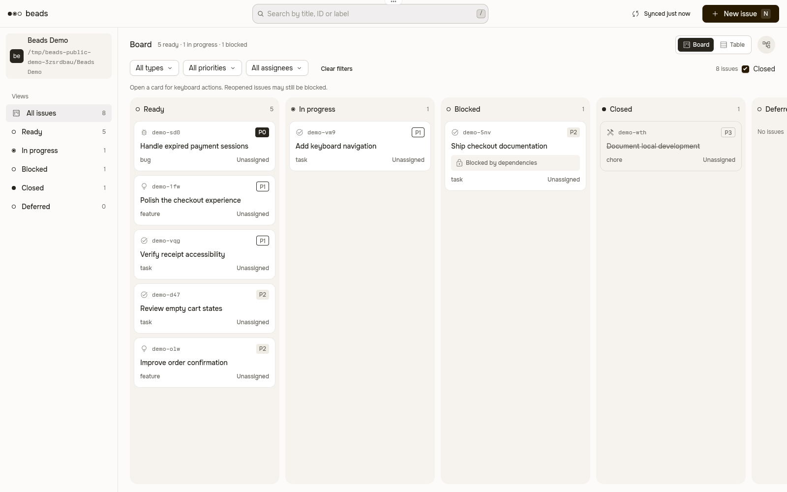
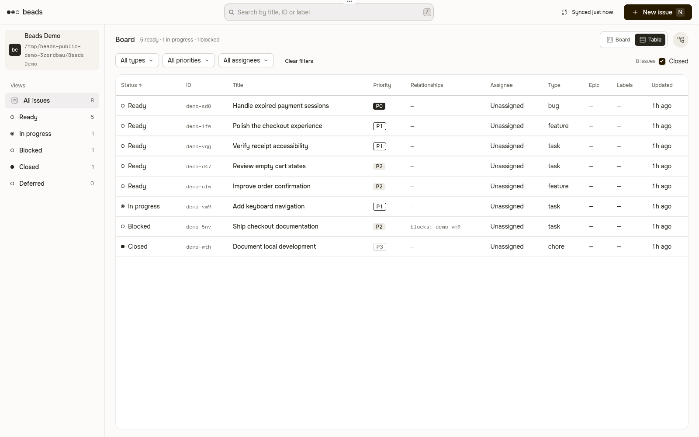
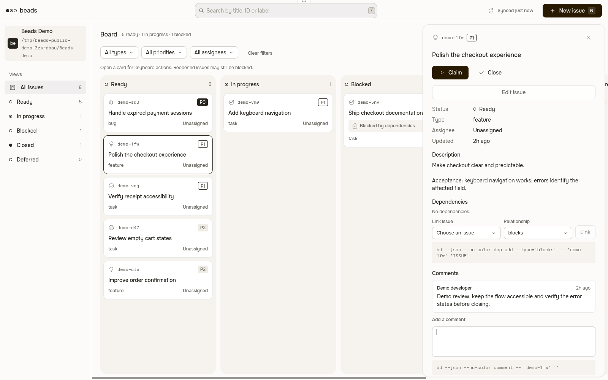

# Beads для Tern

**Дизайн Beads из Orca. Нативно в Tern.**

Находите готовую работу, разбирайте зависимости и обновляйте задачи рядом с терминалом. Это настоящий нативный блок `beads.board`: Luau рисует интерфейс, небольшой TypeScript bridge вызывает установленный Beads CLI. Без браузерного сервера, Electron и runtime другого редактора.

[English](README.md) · [Релизы](https://github.com/Roflochinsky/beads-tern/releases) · [Нативная интеграция](docs/tern.md) · [Согласованный roadmap](docs/product-scope.md)



Настоящий Tern 0.9.12 на Linux и демонстрационный проект Beads. Снимок обрезан по области плагина; это не браузерный макет. Onest был доступен изолированному процессу рендеринга.

**До релиза:** публикация готового пакета остановлена на визуальной приёмке. Установка Onest и компактный режим в split pane требуют отдельного решения. [Ограничения native API](docs/tern.md#proven-api-limitations) не выдаются за паритет 1:1. Ниже доступна установка из исходников.

## Установка

На **машине, где выполняются панели**, нужны:

- Tern с API версии **0.9.12 (`e498b49`)**. Tern распространяется в закрытой бете; совместимость других версий требует проверки.
- **Node.js 24+** и **`bd` 1.3.2** в PATH демона Tern.
- Уже инициализированный проект Beads с `.beads`. Плагин не создаёт и не мигрирует пользовательскую базу.

Для исходной типографики **Onest должен быть доступен клиенту, который рисует интерфейс**, а не только удалённому хосту с bd. [Исходный шрифт в Google Fonts](https://github.com/google/fonts/tree/main/ofl/onest). Tern игнорирует `@font-face` плагина. Плагин не устанавливает шрифты и не меняет тему хоста. Без Onest хост подставляет свой sans; это не паритет дизайна.

Установите текущие исходники как нативный плагин:

```sh
git clone https://github.com/Roflochinsky/beads-tern.git
cd beads-tern
npm ci
npm run build
tern plugin install "$PWD/dist/tern"
tern plugin list --json
```

Откройте shell в проекте Beads и выберите **New Beads block** в палитре Tern. Этот способ требует сборочных зависимостей. После публикации релиза архив будет содержать готовый bridge: проверьте `SHA256SUMS`, распакуйте архив и выполните `tern plugin install "$PWD/tern"`. npm и dev link для готового пакета не нужны.

**Не передавайте URL архива в `tern plugin install`.** По [официальному контракту](https://docs.stencil.so/tern/guides/distribution.md#installing) команда принимает каталог или Git-источник; HTTP(S) URL клонируется Git, а не распаковывается. Исходники этого репозитория требуют сборки: установка корня или `integrations/tern` напрямую не поставляет bridge. Официального marketplace нет.

Установка запускает доверенный код с правами пользователя и перезагружает плагины. Обновление установленной копии: `tern plugin install "$PWD/tern" --force`. Для dev link сначала нужен `tern plugin unlink beads`. Удаление копии: `tern plugin remove beads`; Tern сохраняет данные плагина. Каталог установки узнавайте через `tern plugin dir`.

При переходе с исторического beads-hud native 0.1.2 ID остаётся `beads`, блок — `beads.board`. Независимая нумерация начинается с 0.1.0; Tern не сравнивает версии, поэтому переход выполняется через `--force`. Старые релизы HUD остаются историей, но дальнейшие Tern-обновления принадлежат этому репозиторию.

## Что работает сейчас

- **Выбор работы:** доска и таблица, поиск по названию/ID/метке, фильтры типа/приоритета/исполнителя, статусы и сортировка таблицы. Ready берётся из `bd ready`.
- **Зависимости:** навигация шириной 240 px, горизонтальные колонки, компактные карточки и правая панель 480 px, как в Orca. Переходы по связям, подсветка цепочки и Link/Unlink.
- **Реальные изменения:** модальное создание, inline-редактирование, Claim, Reclaim, Close, Reopen и читаемые комментарии. Статус меняют явные действия, а не произвольное текстовое поле.
- **Бережное редактирование:** отправляются только поля, изменённые относительно исходной формы. Это не атомарная защита от параллельного изменения того же поля.
- **Актуальность:** обновление после записи и фоновый опрос без блокировки локальных контролов. Старый ответ отбрасывается после нового пользовательского запроса. Во время ввода опрос приостанавливается; сохраняются только раскладка и выбранный раздел статусов.

`/` — поиск; `1` / `2` / `3` — Ready / Active / Blocked; `j` / `k` — выбор; `c` — Claim; `x` — Close/Reopen; `n` — создание; `r` — обновление; Escape — отмена. В форме Tab переключает поля, стрелки меняют выбранный вариант, Ctrl/Cmd+Enter сохраняет. Текстовые поля поддерживают Unicode, Shift-выделение и Ctrl/Cmd+A. Настройка **Native composer editing** добавляет выделение мышью и установку каретки. [Подробности](docs/tern.md).

Запуск агентов, передача поручений, массовое назначение, именованные сохранённые фильтры и открытие документов **не реализованы**. Закрытие — отдельное явное действие Beads; завершение агента не закрывает задачу.

### Как выглядит работа

| Таблица | Детали задачи |
| --- | --- |
|  |  |

[Создание задачи](docs/images/tern-create.png) · [Узкое окно](docs/images/tern-narrow.png) · [Детали в узком окне](docs/images/tern-narrow-detail.png)

Эталон — [beads-orca v0.1.2](https://github.com/Roflochinsky/beads-orca/tree/v0.1.2/src/ui), включая SVG Material Symbols. Компактный режим пока зависит от ширины **окна**. В узкой разделённой панели используйте увеличение блока. Пиксельный паритет для split pane не подтверждён.

## Хост, удалённые панели и доверие

Блок работает с `cx.cwd` своей панели. RPC не позволяет выбрать произвольный путь. Для удалённой панели плагин, Node и bd устанавливаются **на удалённом хосте**; bridge и база работают там, а не по похожему локальному пути. Подключённые клиенты отображают нативный блок хоста. Только iOS не может исполнять этот bridge. Общего обзора нескольких хостов пока нет.

Если Node недоступен в PATH демона, задайте `BEADS_TERN_NODE` абсолютным путём к исполняемому файлу **до запуска демона**, без аргументов. Изменение окружения shell не меняет уже работающий демон.

Плагин передаёт argv без shell, не открывает HTTP-порт и не читает ключи моделей. Он доверяет конфигурации проекта и **не является песочницей базы**: в bd 1.3.2 проверка полного локального ID и операция выполняются раздельно; при внешнем удалении между ними возможна гонка с prefix routing. После timeout сначала обновите данные: запись могла завершиться. [Контракт CLI](src/core/README.md).

Tern требует Luau и нативные узлы, а не DOM/TypeScript entry. Рендерер не загружает шрифты плагина. Host API сообщает размер панели в терминальных ячейках, а не пикселях. Паритет с браузерными drag/drop и hover не обещается. API не даёт handle отмены процесса: закрытый блок игнорирует поздний результат, но уже запущенный процесс может завершиться в пределах timeout.

## Согласовано, но ещё не реализовано

Выбор нескольких задач с явным предпросмотром; запуск и передача **только OMP**; учёт блокеров; Claim конкретным исполнителем до начала работы; Markdown-контекст; личная история поручений; сохранённые фильтры; явная доступность удалённых хостов. Без селектора Codex/Claude, автономного диспетчера, скрытых повторов, автоматических merge и закрытия задач. Результат принимает человек. [Все решения и API-границы](docs/product-scope.md).

## Разработка и проверки

```sh
npm ci
npm run typecheck
npm run build
npm test
npm run smoke
npm run package
```

Сборка создаёт `dist/tern`; упаковка — только `release/beads-tern-0.1.0.tar.gz` и `release/SHA256SUMS`. Установка из сборки: `tern plugin install "$PWD/dist/tern"`. Dev link необязателен и не заменяет публичную установку.

Тесты сохраняют поведенческие проверки сервиса и реальной stdin/stdout-границы bridge. `smoke` вызывает собранный bridge с настоящим bd в отдельном временном Git/Beads-проекте, затем удаляет fixture (`-- --keep` сохраняет её). Пользовательская база и OMP-сессия не нужны. Нативный интерфейс принимается только в настоящем окне Tern; [инструкция](docs/tern.md#verification) описывает изоляцию и ручные регрессии. CI не заменяет проверку окна.

CI запускается на main, pull request и тегах `v*`: Node 24, Actions по commit SHA, lockfile и bd 1.3.2 с закреплённой SHA256. Соответствующий версии тег публикует только Tern-архив и контрольные суммы после Linux/macOS-проверок. Наличие workflow не означает успешного прогона.

## Лицензия и владение

[MIT](LICENSE). SVG Material Symbols сохраняют [Apache-2.0](integrations/tern/ICONS-LICENSE). Источник выделения: beads-hud `aea263c8def2e91d7e670fa193bcba1cb9ba8bff`; визуальный эталон — beads-orca v0.1.2. Этот репозиторий владеет Tern; [beads-hud](https://github.com/Roflochinsky/beads-hud) — браузерным HUD и другими нативными платформами; [beads-orca](https://github.com/Roflochinsky/beads-orca) — Orca. Runtime-зависимостей между ними нет.
